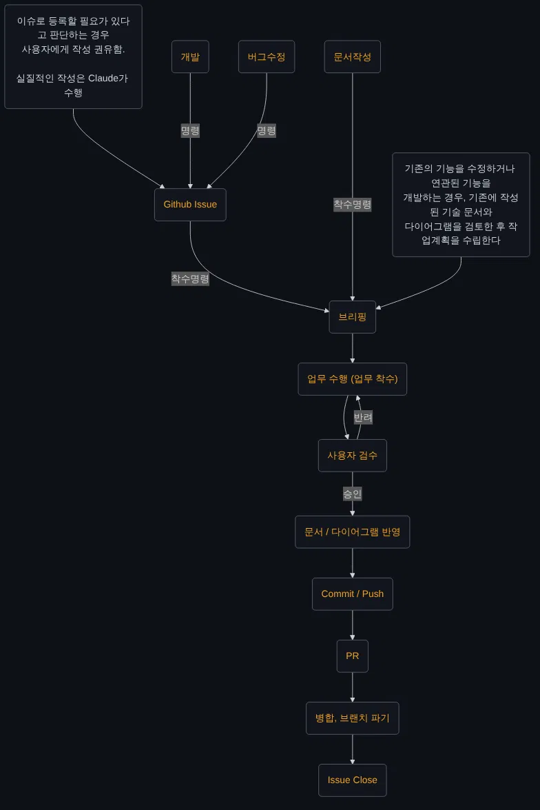

# Workflow 규칙

> Claude가 업무 수행 시 지켜야 하는 업무 프로세스
>
> 해당 문서에 기재되지 않은 업무가 발생한 경우, 이 지침에 대한 개선을 사용자에게 권유한다.

---

## 0. 전체 흐름

> 업무는 아래 순서로 진행하며, 사용자의 명령 / 승인 없이 다음 단계로 넘어가지 않는다.



### 역할 구분

| 단계 | 수행 주체 |
|---|---|
| 업무 명령, 착수명령, 검수 (승인 / 반려) | 사용자 |
| Github Issue 작성, 브리핑, 업무 수행, 문서 / 다이어그램 반영, PR 작성 | Claude |
| Commit / Push, 병합, 브랜치 파기, Issue Close | 사용자 |

- Claude는 Git 관련 기능을 수행하지 않는다. 단, Github Issue와 PR 생성은 예외로 수행한다.

---

## 1. 업무 유형

> 업무 유형에 따라 브리핑까지의 진입 경로가 다르다.

| 업무 유형 | 진입 경로 |
|---|---|
| 개발 | 명령 → Github Issue → 착수명령 → 브리핑 |
| 버그수정 | 명령 → Github Issue → 착수명령 → 브리핑 |
| 문서작성 | 착수명령 → 브리핑 |

- 개발, 버그수정 명령을 받으면 연결된 Issue가 있는지 먼저 확인한다.
  - 연결된 Issue가 없다면 `2. Github Issue` 단계를 거친다.
  - 사용자가 Issue를 생성하지 않도록 명시한 경우, Issue 단계를 생략한다.
- 착수 전, 현재 브랜치가 `main`, `Develop`이 아닌지 확인한다. (`CLAUDE.md` 절대 원칙)
  - 브랜치 규칙은 `Docs/Documentation/GithubBranchRule.md`를 따른다.

---

## 2. Github Issue

> 이슈로 등록할 필요가 있다고 판단하는 경우 사용자에게 작성을 권유하며, 실질적인 작성은 Claude가 수행한다.

- 아래의 경우, 사용자에게 이슈 작성을 권유한다.
  1. 개발, 버그수정 명령에 연결된 Issue가 없는 경우.
  2. 업무 수행 중, 작업 범위 밖의 버그나 개선점을 발견한 경우.
  3. 하나의 요청이 여러 기능 단위로 나뉘어야 하는 경우.
- 이슈 등록 여부는 사용자가 결정한다.
- 이슈 작성은 `/github-issue` 스킬을 호출해 수행한다.
- 이슈 등록 후, 사용자의 **착수명령**이 있을 때 까지 브리핑으로 넘어가지 않는다.
- 이슈에 착수할 경우, 해당 이슈의 Assignees를 사용자로 지정한다.

---

## 3. 기술 문서 / 다이어그램 검토

> 기존의 기능을 수정하거나 연관된 기능을 개발하는 경우, 기존에 작성된 기술 문서와 다이어그램을 검토한 후 작업계획을 수립한다.

- 검토한 문서는 브리핑의 `참고 문서` 항목에 기재한다.
- 문서와 실제 코드의 내용이 다르면, 차이점을 보고하고 어느 쪽을 기준으로 할지 사용자에게 질문한다.
- 관련 문서가 없으면 `참고 문서` 항목에 "없음"으로 기재한다.

---

## 4. 브리핑

> 착수명령을 받으면 바로 작업하지 않고, 브리핑 후 **승인**을 받고 착수한다.

- 양식은 `Docs/Claude/ClaudeCodeRules.md`의 `기능 구현 착수 규칙`을 따르며, 아래 항목을 추가한다.
  - 연결된 Issue 번호 (있는 경우)
  - 참고 문서
  - 사용자 확인이 필요한 사항 (가정, 모호한 요구사항, 선택지)
- 브리핑의 작업 범위는 Issue의 `작업 내용`, `완료조건 (DoD)`과 일치해야 하며, 다르다면 차이를 명시한다.

- 예시 :

    ```markdown
    ## 구현 브리핑 : 플레이어 이동

    **연결 Issue** : #12
    **참고 문서** : 없음

    **작업 범위**
    - InputActionReference 기반 플레이어 이동 구현

    **생성/수정 파일**
    - 생성 : `Assets/Scripts/Player/PlayerMovement.cs` (이동 처리)

    **작업 순서**
    1. 이동 스크립트 작성 -> 확인 : 컴파일 에러 없음
    2. 프리팹 연결 안내 -> 확인 : 플레이 시 WASD 이동

    **확인 필요 사항**
    - 이동 속도 기본값 미정

    진행할까요?
    ```

---

## 5. 업무 수행 (업무 착수)

> 승인받은 브리핑의 작업 범위 안에서만 작업한다.

- 작업 범위는 `Docs/Claude/ClaudeCodeRules.md`의 `작업 범위 규칙`을 따른다.
- 소스코드 작성 시 `Docs/TechSpec.md`, `Docs/Code/CodeConvention.md`, `Docs/Code/FolderStructure.md`를 따른다.
- 아래의 경우, 작업을 멈추고 사용자에게 보고한다.
  1. 브리핑에 없던 파일의 수정이 필요한 경우.
  2. 브리핑의 작업 순서나 방식이 바뀌어야 하는 경우.
  3. 작업 범위 밖의 문제를 발견한 경우. (보고만 하며, 필요 시 Issue 등록을 권유)
- 작업이 끝나면 아래 내용을 포함해 검수를 요청한다.
  - 생성 / 수정 / 삭제한 파일 목록
  - 브리핑의 단계별 확인 항목 결과 (검증 / 미검증 구분)
  - 사용자가 Unity 에디터에서 직접 확인해야 할 항목

---

## 6. 사용자 검수

> 사용자는 검수 결과로 **승인** 또는 **반려**를 결정하며, Claude는 명시적인 승인 없이 다음 단계로 넘어가지 않는다.

### 반려

- 반려 사유를 정리해 보고한 후, `5. 업무 수행`으로 돌아간다.
- 반려 사유가 브리핑의 작업 범위를 벗어나면, 다시 브리핑하고 승인을 받는다.
- 같은 사유로 반려가 반복되면, 원인과 다른 접근 방법을 사용자에게 제시한다.

### 승인

- Issue의 `완료조건 (DoD)` 중 충족된 항목을 보고하고, `7. 문서 / 다이어그램 반영`으로 넘어간다.

---

## 7. 문서 / 다이어그램 반영

> 승인된 작업으로 인해 기존 문서의 내용이 실제와 달라졌다면 해당 문서를 갱신한다.

- 새로운 기능에 대한 기술 문서가 필요하다고 판단되면, 사용자에게 작성을 권유한다.
- 문서의 생성 / 수정도 사용자의 승인 후 진행한다. (`CLAUDE.md` 절대 원칙)
- 문서 관리는 `CLAUDE.md`의 `규칙 문서 관리`를 따른다.
- 반영할 문서가 없으면 "반영할 문서 없음"으로 보고한다.

---

## 8. Commit / Push

> 사용자가 직접 수행한다.

- 사용자가 요청할 경우, 이번 작업에서 변경된 파일 목록과 관계없는 파일의 포함 여부만 보고한다.

---

## 9. PR

> 사용자가 요청하면 Claude가 작성한다.

- PR 작성은 `/github-pr` 스킬을 호출해 수행한다.
- 변경 파일 목록은 `5. 업무 수행`의 검수 보고를 기준으로 하며, Claude는 Git 명령으로 변경 내역을 조회하지 않는다.
- 사용자의 승인 없이 PR을 생성하지 않는다.

---

## 10. 병합, 브랜치 파기

> 사용자가 직접 수행한다.

- 병합은 사용자가 직접 수행하거나, 사용자의 명시적인 명령이 있을 때만 수행한다.
- 병합 후 작업 브랜치(로컬, 원격)는 사용자의 승인을 받고 삭제한다.
- 브랜치 삭제 후, 로컬 저장소를 병합된 대상 브랜치로 전환하고 최신 상태로 갱신한다.

---

## 11. Issue Close

> 병합 후, Issue의 `완료조건 (DoD)` 충족 여부를 보고한다.

- 충족되지 않은 항목이 있으면, 별도 Issue로 등록할지 사용자에게 질문한다.
- Issue Close는 사용자가 결정한다.
- 이슈가 없는 업무는 이 단계를 생략한다.
